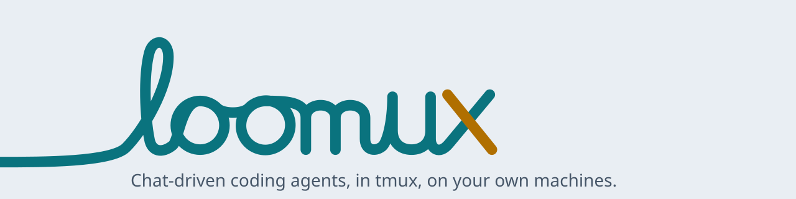

<picture>
  <source media="(prefers-color-scheme: dark)" srcset="docs/brand/banner-dark.svg">
  
</picture>

# loomux/tui

`loomux`, the terminal client for [Loomux](https://github.com/loomux/server).
It shows an attention-first list of conversations and lets you chat with a
live stream and answer blocked prompts and offers. You can also attach to a
running agent's tmux session from your own terminal and hand work back to
the web client.

## Status

**Pre-release, not usable yet.** So far there is `loomux version`, plus
the config file, the token stores that `loomux login` will use and the
keymap the screens will use. Logging
in, the list, chat and attach are added ticket by ticket, following the
build plan in the design.

## Design

The design is
[`docs/design/tui-client-design.md`](https://github.com/loomux/server/blob/main/docs/design/tui-client-design.md)
in `loomux/server`. It stays in that repository, together with every API
change, because that's where the API is.

## Building from source

You need Go at the version in `go.mod` or later.

```sh
git clone https://github.com/loomux/tui.git
cd tui
go build ./cmd/loomux
./loomux version
```

`loomux version` prints the client's version and the
`github.com/Loomux/server` release it is pinned to, for example:

```
loomux v0.0.0-20261105205442-e9cf01ab4ff8
server pin v0.3.143
```

A release build prints its release version. A build from a git checkout
prints the pseudo-version Go stamps from the commit, and a build with no
version information prints `dev`.

The client pins the server as a Go module requirement on a release tag.
Only test files import it, and none of it is linked into the binary. After
bumping the pin (`go get github.com/Loomux/server@v0.3.N`), run
`go generate ./...` to update `internal/version/serverpin.go`. A test fails
if it doesn't match `go.mod`.

## Configuration

The config file is `$XDG_CONFIG_HOME/loomux/config.toml`. Without
`XDG_CONFIG_HOME` it is `~/.config/loomux/config.toml`, or
`~/Library/Application Support/loomux/config.toml` on macOS:

```toml
default_profile = "test"
token_store = "keyring"  # or "file"

[profiles.test]
server = "https://loomux.example.net"

[profiles.prod]
server = "https://loomux.example.org"
warn = true
```

- **Profiles.** `--profile`, then `LOOMUX_PROFILE`, then
  `default_profile` choose the profile, and a config with a single
  profile uses it. `LOOMUX_SERVER` overrides the profile's server URL. It
  also works with no config file, as profile `default`.
- **HTTPS only.** A server URL must be `https://`. `http://` is accepted
  only for `localhost` and loopback addresses. A URL without a scheme is
  refused, and the error suggests the `https://` form.
- **No token in the config.** An unknown key is an error, and a key like
  `token` is refused outright.
- **Token store.** `token_store = "keyring"`, the default, keeps the token
  in the OS keyring: Secret Service on Linux (GNOME Keyring, KWallet,
  KeePassXC) or the Keychain on macOS. Where there's no keyring, `loomux`
  stops and tells you how to opt in to the file store; it never falls
  back on its own. `token_store = "file"` keeps the token in a `0600` file
  per profile under `$XDG_STATE_HOME/loomux/` (default
  `~/.local/state/loomux/`), in a `0700` directory. A token file or
  directory with wider permissions is refused, not used. Every start
  warns that the token is in a plain file.

### Keys

Every key is an action with a vim-style default, and `[keys]` replaces
any action's keys with a key or a list of keys:

```toml
[keys]
attach = "A"
send = "ctrl+s"
cancel = ["x", "ctrl+c"]
```

Keys are written as Bubble Tea names them: a character (`a`, `A`, `?`),
a named key (`enter`, `esc`, `tab`, `space`, `backspace`, `delete`,
`up`, `pgdown`, `home`, `f1` to `f20`, …), or `ctrl+`, `alt+` or (with a
named key) `shift+` before one. An unknown action, something that isn't
a key, or two actions with the same key on one screen stops `loomux` at
start with an error that names them. In the composer and the list's
filter a key that types text types it, so `send`, `newline`, `cancel`,
`back` and `apply` each need a `ctrl+`, `alt+` or named key. `choose`'s keys pick options 1, 2, 3… in order. `?` shows the keys
in effect on the current screen.

| Action | Default keys | Screens | What it does |
|---|---|---|---|
| `up` | `k` `up` | list, conversation, transcript, help | move up |
| `down` | `j` `down` | list, conversation, transcript, help | move down |
| `page_up` | `pgup` `ctrl+u` | list, conversation, transcript, help | page up |
| `page_down` | `pgdown` `ctrl+d` | list, conversation, transcript, help | page down |
| `top` | `g` `home` | list, conversation, transcript, help | go to the top |
| `bottom` | `G` `end` | list, conversation, transcript, help | go to the bottom |
| `open` | `enter` | list | open the conversation |
| `back` | `esc` | list, conversation, composer, transcript, help, filter | back |
| `filter` | `/` | list | filter |
| `apply` | `enter` | filter | keep the filter |
| `next_group` | `tab` | list | show needs you, running, done or all |
| `new` | `n` | list | new conversation |
| `attach` | `a` | list, conversation | attach to the agent |
| `watch` | `w` | list, conversation | watch the agent (read-only) |
| `browser` | `o` | list, conversation | open in the browser |
| `transcript` | `p` | conversation | show the task's transcript |
| `cancel` | `x` `ctrl+c` | conversation, composer | cancel the turn in flight |
| `yes` | `y` | conversation | answer yes |
| `no` | `n` | conversation | answer no |
| `choose` | `1-9` | conversation | choose an option by its number |
| `reply` | `r` | conversation | reply with text |
| `send` | `enter` | composer | send |
| `newline` | `alt+enter` | composer | new line |
| `help` | `?` | list, conversation, transcript, help | help |
| `quit` | `q` | list, conversation, transcript, help | quit |

## License

[MIT](LICENSE)
